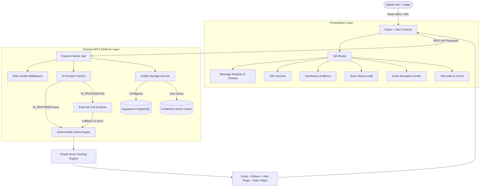

# 🛡️ AI Scam Guardian

> **"Detect the scam before you take the bait."**

[](https://opensource.org/licenses/MIT)
[](https://www.typescriptlang.org/)
[](https://reactjs.org/)
[](https://vitejs.dev/)
[](https://nodejs.org/)

**AI Scam Guardian** is a full-stack cybersecurity web application built for ordinary digital citizens to analyze suspicious SMS messages, emails, WhatsApp texts, job offers, payment requests, and URLs. Developed under the hackathon track: **AI for Everyday Life**.

Rather than returning a black-box answer, AI Scam Guardian provides an **explainable risk breakdown**, identifies psychological manipulation patterns, highlights suspicious triggers in the original text, and delivers concrete, safer alternative actions.

---

## 📑 Table of Contents

- [The Problem](#-the-problem)
- [Our Solution](#-our-solution)
- [Key Differentiators](#-key-differentiators)
- [Architecture & Tech Stack](#-architecture--tech-stack)
- [System Architecture (Mermaid)](#-system-architecture)
- [AI Engine & Threat Vectors](#-ai-engine--threat-vectors)
- [Database Schema (Supabase)](#-database-schema)
- [API Endpoints](#-api-endpoints)
- [Quick Start & Local Setup](#-quick-start--local-setup)
- [Environment Variables](#-environment-variables)
- [Hackathon Demo Walkthrough](#-hackathon-demo-walkthrough)
- [Roadmap & Future Scope](#-roadmap--future-scope)

---

## 🚨 The Problem

Cyber scams are evolving at breakneck speed:
- **High-urgency smishing & phishing** (fake bank deactivation, KYC deadlines).
- **Advance-fee lottery scams** (promising ₹50,000 but demanding ₹499 upfront).
- **Work-from-home task scams** (Telegram prepaid commission traps).
- **Spoofed URLs & brand lookalikes** (using raw IP hosts or high-abuse TLDs).

Everyday people—students, parents, and senior citizens—often have limited cybersecurity knowledge and panic under pressure.

---

## 💡 Our Solution

AI Scam Guardian acts as a trustworthy, calm digital safety companion:
1. **Paste**: Paste any SMS, email, social message, or URL.
2. **Analyze**: Multi-vector behavioral evaluation across 7 threat indicators.
3. **Understand**: Visual risk score gauge, highlighted trigger phrases, and open point calculations.
4. **Protect**: Actionable safety recommendations and verified official pathways.

---

## 🌟 Key Differentiators

1. **"Why Should I Trust This Result?" (Explainable AI)**
   - No black-box verdicts. Transparent point additions:
     - Urgency Tactics: `+16`
     - Advance Financial Request: `+22`
     - External Link Trap: `+20`
     - Unexpected Prize Claim: `+18`
     - Compound Scam Synergy: `+18`
2. **Identified Scam Pattern Formula**
   - Synthesizes formulas like `Urgency + Reward Promise + Payment Request + External Link Trap` to educate users on underlying attack signatures.
3. **Safer Alternative Guidance**
   - Never leaves the user hanging. Directly tells the user what official app or channel to use instead of taking the bait.
4. **100% Offline Demo Reliability + Cloud LLM Switch**
   - Runs out-of-the-box using the deterministic `LocalScamAnalyzer` or seamlessly routes to external LLMs when `LLM_API_KEY` is provided.

---

## 🏗️ Architecture & Tech Stack

| Component | Technology | Description |
| :--- | :--- | :--- |
| **Frontend** | React 18, Vite, TypeScript | Fast, responsive single-page application |
| **Styling** | Tailwind CSS, Lucide Icons | Cybersecurity-inspired navy & blue palette |
| **Data Viz** | Recharts | Risk distribution pie charts & scan timeline graphs |
| **Animation** | Framer Motion | Smooth state transitions & multi-stage scanning radar |
| **Backend** | Node.js, Express, TypeScript | REST API with rate limiting & error shielding |
| **Database** | Supabase (PostgreSQL) | Structured schema with Row Level Security (RLS) + In-memory demo fallback |
| **AI Engine** | Modular ScamAnalyzer | Deterministic rule engine + pluggable LLM interface |

---

## 📊 System Architecture



---

## 🧠 AI Engine & Threat Vectors

The analyzer inspects 7 core threat vectors:
1. **Urgency Tactics**: "act now", "immediately", "within 24 hours", "account will be blocked".
2. **Financial Requests**: "processing fee", "registration charge", "send money", "UPI PIN".
3. **Credential Harvesting**: "OTP", "CVV", "password", "verification code".
4. **Reward / Prize Hooks**: "won lottery", "selected to receive ₹50,000", "cash reward".
5. **Job & Task Scams**: "earn ₹3,500 daily", "YouTube like task", "Telegram mentor".
6. **Institutional Impersonation**: Spoofed bank, police, customs, or courier identity.
7. **Hyperlinks & Phishing**: Raw IP addresses, lookalike domains, shortened URLs.

### Scoring Scale:
- `0 – 29`: **SAFE** (Green shield)
- `30 – 59`: **SUSPICIOUS** (Amber alert)
- `60 – 100`: **HIGH RISK** (Red threat)

---

## 🗄️ Database Schema

The database is designed for **Supabase PostgreSQL** with full Row Level Security:

```sql
-- Scans Table
CREATE TABLE public.scans (
    id UUID PRIMARY KEY DEFAULT uuid_generate_v4(),
    user_id UUID REFERENCES auth.users(id),
    scan_type TEXT CHECK (scan_type IN ('message', 'url')),
    input_text TEXT NOT NULL,
    risk_score INTEGER CHECK (risk_score >= 0 AND risk_score <= 100),
    risk_level TEXT CHECK (risk_level IN ('SAFE', 'SUSPICIOUS', 'HIGH')),
    category TEXT NOT NULL,
    confidence NUMERIC(4,2) DEFAULT 0.95,
    explanation TEXT NOT NULL,
    scam_pattern TEXT,
    safer_alternative TEXT,
    indicators JSONB DEFAULT '{}'::jsonb,
    red_flags JSONB DEFAULT '[]'::jsonb,
    suspicious_phrases JSONB DEFAULT '[]'::jsonb,
    recommendations JSONB DEFAULT '[]'::jsonb,
    score_breakdown JSONB DEFAULT '[]'::jsonb,
    created_at TIMESTAMPTZ DEFAULT NOW()
);
```

Full schema available in [`supabase/schema.sql`](file:///d:/AI%20Scam%20Message%20Guardian/supabase/schema.sql).

---

## 🔌 API Endpoints

| Method | Endpoint | Description |
| :--- | :--- | :--- |
| `POST` | `/api/analyze/message` | Analyzes suspicious text message |
| `POST` | `/api/analyze/url` | Scans URL for domain & phishing signals |
| `GET` | `/api/scans` | Returns scan audit history with filters |
| `GET` | `/api/scans/:id` | Returns single scan record details |
| `DELETE` | `/api/scans/:id` | Deletes a scan record |
| `GET` | `/api/analytics` | Returns aggregate metrics and chart data |
| `GET` | `/api/health` | Health check endpoint |

---

## 🚀 Quick Start & Local Setup

### Prerequisites
- Node.js `v18+` or `v22+`
- npm `v9+`

### 1. Clone & Install Dependencies

```bash
# Clone the repository
git clone https://github.com/your-username/ai-scam-guardian.git
cd ai-scam-guardian

# Install backend dependencies
cd backend && npm install

# Install frontend dependencies
cd ../frontend && npm install
```

### 2. Start the Backend API (Port 5000)

```bash
cd backend
npm run dev
```

### 3. Start the Frontend Web App (Port 5173)

```bash
# In a second terminal
cd frontend
npm run dev
```

Open your browser to: **`http://localhost:5173`**

### 4. Run Verification Tests

```bash
cd backend
npm test
```

---

## ⚙️ Environment Variables

### Backend (`backend/.env`)
```ini
PORT=5000
NODE_ENV=development
FRONTEND_URL=http://localhost:5173

# 'local' (zero setup, deterministic rules) or 'llm' (external provider)
AI_PROVIDER=local

# Optional external LLM API
LLM_API_KEY=
LLM_MODEL=gpt-4o-mini
LLM_API_BASE=https://api.openai.com/v1

# Optional Supabase credentials (fallback to in-memory demo DB if empty)
SUPABASE_URL=
SUPABASE_ANON_KEY=
SUPABASE_SERVICE_ROLE_KEY=
```

### Frontend (`frontend/.env`)
```ini
VITE_API_URL=http://localhost:5000/api
VITE_SUPABASE_URL=
VITE_SUPABASE_ANON_KEY=
```

---

## 🎬 Hackathon Demo Walkthrough

Follow this exact sequence for a judge demo:
1. **Open Landing Page**: View hero headline: *"Detect the Scam Before You Take the Bait."*
2. **Click "Analyze a Message"**: Navigate to the core analyzer.
3. **Click "Try Prize Scam" preset**: Populates the official ₹50,000 prize message with ₹499 fee.
4. **Click "Analyze with AI"**: Watch the 5-stage scanning radar transition.
5. **Review Result**:
   - Circular Gauge: `92/100 HIGH RISK`
   - Category: `Prize / Reward Scam`
   - Scam Pattern: `Urgency + Reward Promise + Payment Request + External Link Trap`
   - Red Flags & Trigger Phrases highlighted in original message.
   - Click *"Why Should I Trust This Result?"* to view exact point breakdown.
   - View *"Recommended Safer Alternative"*.
6. **Open History**: Show that the analysis was automatically audited.
7. **Open Analytics**: View the Recharts risk distribution and scam category charts.
8. **Test Safe Message**: Select "Try Safe Message" (`"Hey, are we still meeting at 5 PM today?"`) → shows **SAFE (4/100)** to demonstrate that the system does not falsely flag all text.
9. **Scan URL**: Test `http://192.168.1.1/login-verify.php` → detects raw IP + unencrypted HTTP.

---

## 🔮 Roadmap & Future Scope

- **Browser Extension**: Real-time pop-up notification when visiting unverified payment portals.
- **Multilingual NLP**: Support for regional Indian languages (Hindi, Tamil, Telugu, Bengali).
- **OCR Image Scanner**: Upload screenshots of WhatsApp and Telegram chats directly.
- **Community Threat Feed**: Crowdsourced reporting database cross-checked with national cyber crime portals.

---

## 📄 License

MIT License. Designed with pride for everyday digital safety.
